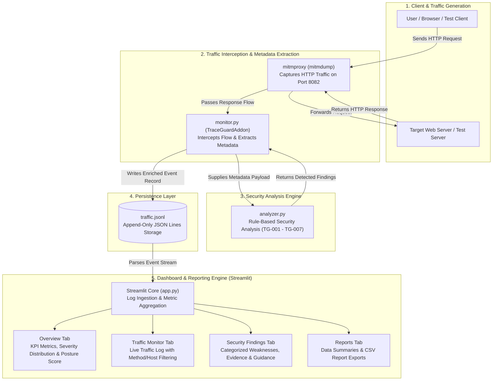

# TraceGuard
### Proxy-Based Web Traffic Monitoring and Security Analysis System

**TraceGuard** is a Python-based network security monitoring project that captures HTTP traffic using mitmproxy, analyzes responses for common security misconfigurations, and displays the results through an interactive Streamlit dashboard.

## 1. Problem Statement

Web applications may contain security misconfigurations such as unencrypted HTTP communication, missing security headers, and improperly configured cookies.

Identifying these issues manually can be time-consuming. TraceGuard aims to simplify this process by monitoring web traffic and automatically highlighting selected security indicators.

## 2. Objectives

- Capture HTTP traffic through a proxy.
- Monitor request and response metadata.
- Identify common security misconfigurations.
- Assign severity levels to detected findings.
- Display captured traffic and findings through a dashboard.
- Generate downloadable reports for further analysis.

## 3. Technologies Used

| Technology | Purpose |
|---|---|
| Python | Core programming language |
| mitmproxy | HTTP traffic interception |
| Streamlit | Interactive dashboard |
| Pandas | Data processing |
| Plotly | Data visualization |
| JSONL | Traffic log storage |
| CSV | Report generation |

## 4. System Architecture

TraceGuard follows a modular, pipeline-based architecture designed for passive web traffic inspection and automated security analysis. The system captures live HTTP network interactions via an intercepting proxy, evaluates security headers and cookie configurations against rule-based checks, persists structured telemetry, and renders analytical dashboards with report export capabilities.

### 4.1 Architecture Workflow Diagram



### 4.2 Data Flow and Processing Pipeline

The project workflow operates across seven integrated stages:

1. **User / Browser / Test Client:** An end user, web browser, or test client initiates HTTP requests targeted at web applications or local test endpoints (such as `test_server.py`) routed through the configured proxy host (`127.0.0.1:8082`).
2. **mitmproxy Interception:** `mitmdump` intercepts HTTP traffic in real time, capturing both request headers and server response payloads without altering payload integrity.
3. **Metadata Extraction (`monitor.py`):** The `TraceGuardAddon` intercepts the HTTP response flow. It sanitizes target URLs (stripping query strings and fragments for data privacy), computes round-trip latency (`response_time_ms`), and extracts metadata including HTTP method, status codes, relevant headers, and parsed cookie attributes (`Secure`, `HttpOnly`, `SameSite`).
4. **Security Rule-Based Analysis (`analyzer.py`):** The extracted event is evaluated against predefined security checks (rules `TG-001` through `TG-007`). The engine flags unencrypted communication, missing security headers (`Content-Security-Policy`, `X-Content-Type-Options`, `Strict-Transport-Security`), and insecure cookie settings, generating structured findings with severity levels and recommendations.
5. **Log Persistence (`traffic.jsonl`):** Each enriched transaction record—combining transmission metadata and detected security findings—is appended as an individual line in `traffic.jsonl` in JSON Lines format.
6. **Log Ingestion (`app.py`):** The Streamlit analytical application reads `traffic.jsonl`, parses JSON lines into structured Pandas DataFrames, and calculates metrics such as domain counts, flagged requests, average latency, and an illustrative configuration security score.
7. **Interactive Dashboard & Reporting:** The Streamlit dashboard visualizes the findings across four dedicated modules:
   - **Overview:** Displays high-level KPIs, severity distribution bar charts, configuration posture score gauge, and status code distributions.
   - **Traffic Monitor:** Provides an interactive data table of recorded traffic with host and HTTP method filters.
   - **Security Findings:** Presents categorized alerts grouped by severity with expandable panels detailing evidence and remediation guidance.
   - **Reports:** Summarizes findings and provides downloadable CSV exports (`traceguard_traffic.csv`, `traceguard_findings.csv`, and `traceguard_severity_summary.csv`).

## 5. Security Checks

TraceGuard currently implements the following detection rules:

| Rule ID | Security Check | Severity |
|---|---|---|
| TG-001 | Unencrypted HTTP | High |
| TG-002 | Missing Content-Security-Policy | Low |
| TG-003 | Missing X-Content-Type-Options | Low |
| TG-004 | Missing HSTS header | Low |
| TG-005 | Cookie missing Secure | Medium |
| TG-006 | Cookie missing HttpOnly | Low |
| TG-007 | Cookie missing SameSite | Low |

These findings indicate potential security misconfigurations and should be reviewed in the context of the application.

## 6. Dashboard Features

- **Overview:** Displays overall monitoring statistics and visual summaries.
- **Traffic Monitor:** Shows captured requests, hosts, methods, URLs, status codes, and response times.
- **Security Findings:** Displays detected issues with severity, evidence, and recommendations.
- **Reports:** Provides downloadable CSV reports for traffic, findings, and severity summaries.

## 7. Project Structure

```text
TraceGuard/
│
├── analyzer.py
├── monitor.py
├── app.py
├── test_server.py
├── test_analyzer.py
├── requirements.txt
├── .gitignore
└── README.md
```

Note: `traffic.jsonl` is generated automatically at runtime during traffic capture and is not tracked as a source file. The `.venv` directory contains the local Python virtual environment and is not part of the source code.

## 8. Installation and Execution

### Step 1: Install dependencies

```bash
pip install -r requirements.txt
pip install mitmproxy
```

### Step 2: Start the local test server

```bash
python test_server.py
```

### Step 3: Start the monitoring proxy

```bash
mitmdump --listen-host 127.0.0.1 --listen-port 8082 -s monitor.py
```

### Step 4: Generate test traffic

Configure an HTTP client to use `127.0.0.1:8082` as its proxy and access the local test endpoint at:

```text
http://127.0.0.1:8001/
```

### Step 5: Start the dashboard

```bash
streamlit run app.py
```

Open the dashboard at:

```text
http://localhost:8501
```

## 9. Testing

The project includes automated unit tests for the security analysis engine.

Run them using:

```bash
python -m unittest test_analyzer.py
```

The tests cover HTTP detection, missing security headers, cookie attributes, and correctly configured cookies.

## 10. Limitations

- The current implementation focuses on selected HTTP security indicators.
- It does not perform a complete penetration test or vulnerability assessment.
- Findings are indicators for manual review, not proof of exploitable vulnerabilities.
- The monitoring proxy is designed for a local testing environment.
- HTTPS inspection requires appropriate proxy certificate configuration.
- The dashboard displays previously captured data from the traffic log.

## 11. Future Scope

- Add more security detection rules.
- Introduce advanced traffic analysis.
- Add filtering by date and severity.
- Implement real-time dashboard updates.
- Improve report generation.
- Expand testing across different web applications.

## 12. Conclusion

TraceGuard demonstrates how proxy-based traffic monitoring and automated security analysis can be combined to identify common web security misconfigurations.

By integrating mitmproxy, Python-based analysis, and an interactive Streamlit dashboard, the project provides a practical approach to understanding and monitoring web traffic security.